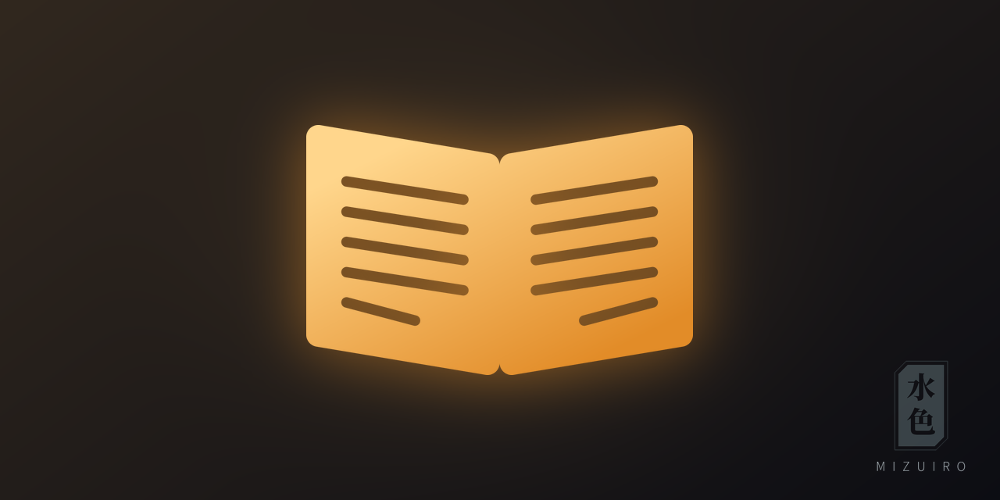
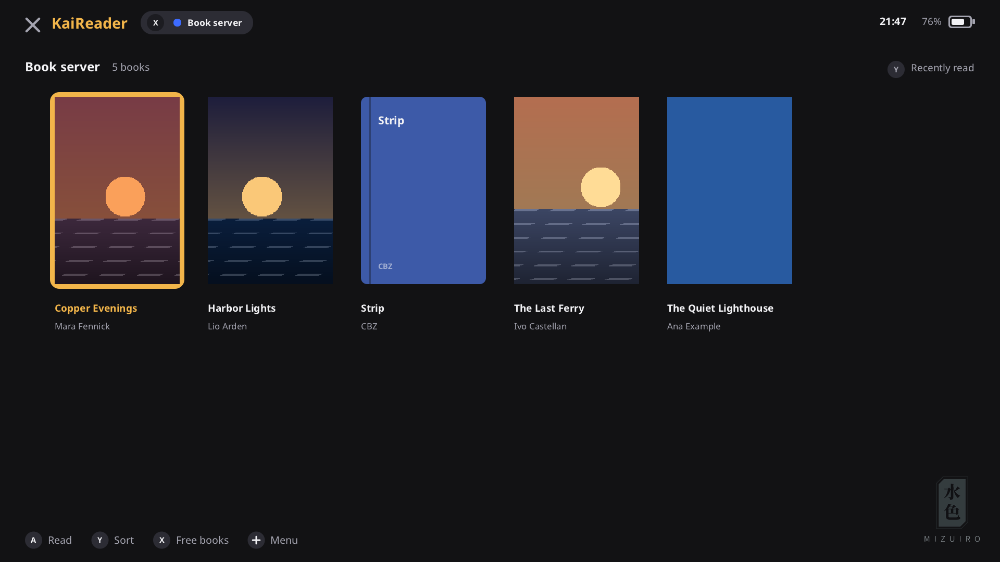
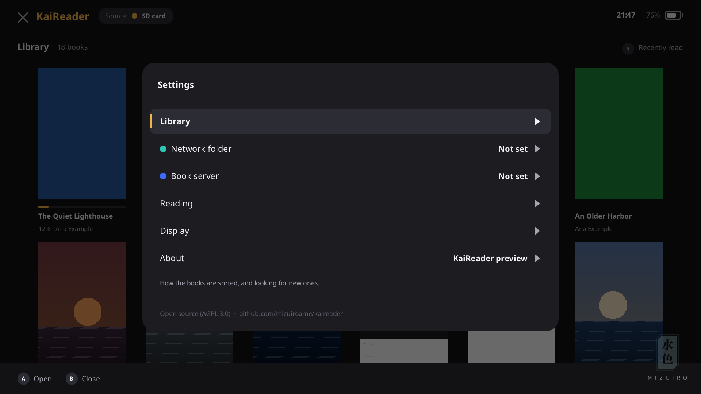
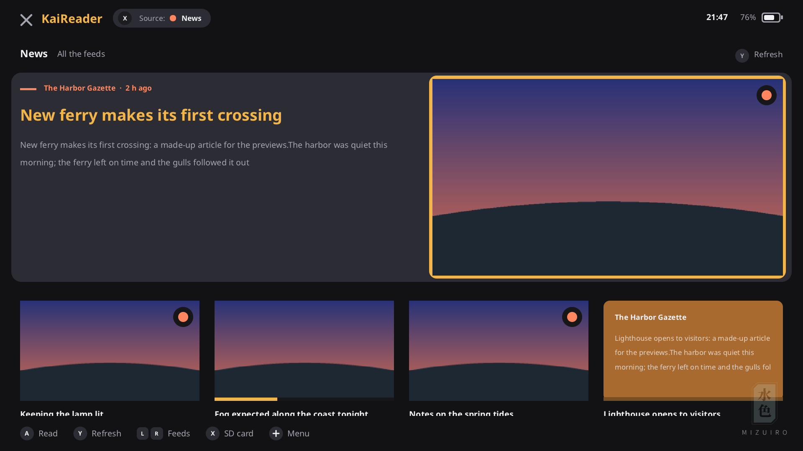
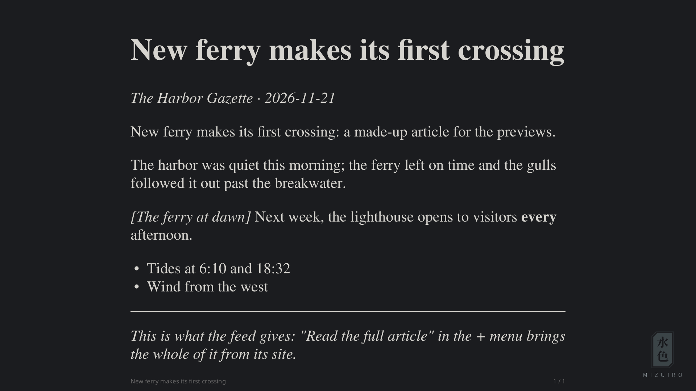
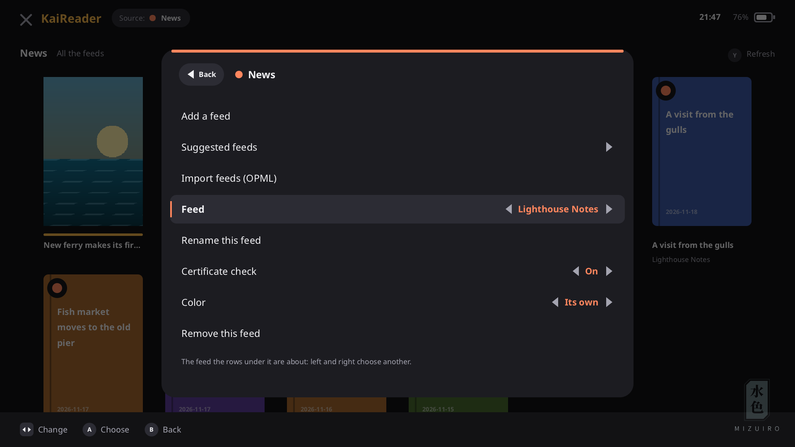

# KaiReader

A **book reader** for **Switch 2** running
[kaiHEN](https://github.com/ouncebrew/kaihen), a sibling of
[KaiPlayer](https://github.com/mizuiroame/kaiplayer),
[KaiRadio](https://github.com/mizuiroame/kairadio) and
[KaiVideo](https://github.com/mizuiroame/kaivideo). Your DRM-free books from
the SD card, a folder on your network or your book server (Calibre-Web,
Kavita, Komga), and free books from Project Gutenberg, Standard Ebooks,
textos.info (Spanish), Ebooks libres et gratuits (French) and unglue.it
(Creative Commons), as on an e-reader: **EPUB**, **PDF**,
comics (**CBZ**, **CBR**, **CB7**, **CBT**), **FB2**, **MOBI**, **TXT** and
**XPS**, drawn with [MuPDF](https://mupdf.com/). Also **news** from the
websites you follow (RSS and Atom feeds), on a front page of their own.

| Reading | Upright, like a book | Free books |
|---------|----------------------|------------|
|  |  |  |

| Two pages, like an open book | Your book server (OPDS) | Each source with its color |
|------------------------------|-------------------------|----------------------------|
|  |  |  |

| News from websites | An article, with its pictures | Settings > News |
|--------------------|-------------------------------|-----------------|
|  |  |  |

The screenshots show made-up books. [More screenshots](docs/screenshots.md)

> **Version 1.3.** In English, Spanish, French, Italian, Portuguese, German,
> Japanese, Chinese and Korean; the translations haven't been reviewed by
> native speakers yet, and corrections are welcome.

> KaiReader is an independent project. It is not affiliated with, endorsed by
> or sponsored by Nintendo or Amazon. See the [legal notice](docs/legal.md).

## What it can do

- **Your library** from `sdmc:/books`, with covers, sorted by recently read,
  favorites, title, author or genre, as a grid or a list.
  [More](docs/features.md#library)
- **Reading** with ten text sizes and four colors, zoom on PDFs and comics,
  bookmarks, contents, two pages side by side, and upright like a book.
  [More](docs/features.md#reading)
- **Books from your network** (SMB, WebDAV, FTP, SFTP) and **your book server**
  (Calibre-Web, Kavita, Komga), as libraries of their own.
  [More](docs/features.md#where-the-books-come-from)
- **Free books**: Project Gutenberg and Standard Ebooks, textos.info in
  Spanish, Ebooks libres et gratuits in French and unglue.it's Creative
  Commons books, each with its search, downloaded to your library. [More](docs/features.md#where-the-books-come-from)
- **News** from any site's RSS or Atom feed (or an OPML file), with suggested
  feeds in each language: a front page with the latest stories, articles that
  scroll like a web page with their pictures, and **A** brings the full article
  from its site. [More](docs/features.md#news)
- **Nine languages**, your accent color and a background picture, and updates
  from GitHub. [More](docs/features.md#looks-languages-and-updates)
- **Touch and buttons** for everything. [Controls](docs/controls.md)

## Install

You need a Switch 2 with **kaiHEN** running (launch a game while holding
**R** to open hbmenu), and a way to copy files to the card (OunceShell's FTP
server, for example).

1. Copy `KaiReader.nro` to `sdmc:/switch/kaireader/`.
2. Put your books in `sdmc:/books/` (folders inside it are fine).
3. Open KaiReader from hbmenu.

**Names with accents** are hidden by the console: copy your books with
[KaiDrop](https://github.com/mizuiroame/kaidrop), or rename them first.
[Installing](docs/install.md) has the details, and where KaiReader keeps its
files.

## Documentation

- [What it can do](docs/features.md): the library, reading, network folders,
  the book server, Free books, looks and updates
- [Controls](docs/controls.md): buttons and the touch screen
- [Installing](docs/install.md): names with accents, KaiReader's files, updating
- [Screenshots](docs/screenshots.md)
- [Security](docs/security.md): how the accounts are kept on the card, and the
  risks that remain
- [Building](docs/building.md): from source, with Docker
- [Legal notice and licenses](docs/legal.md)

## License

GNU AGPL 3.0 or later ([LICENSE](LICENSE)), as MuPDF is. The other parts and
their licenses are in the [legal notice](docs/legal.md).
