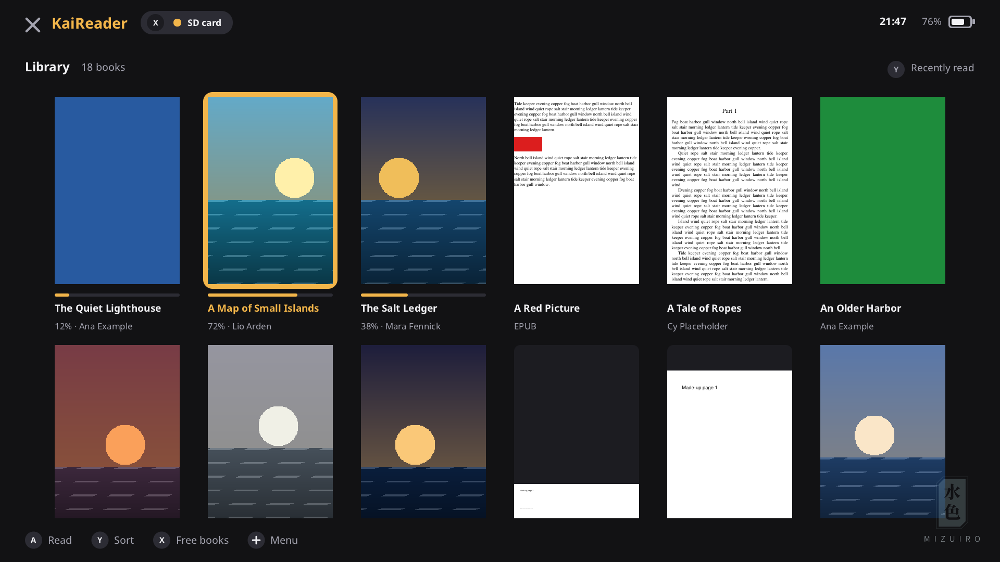
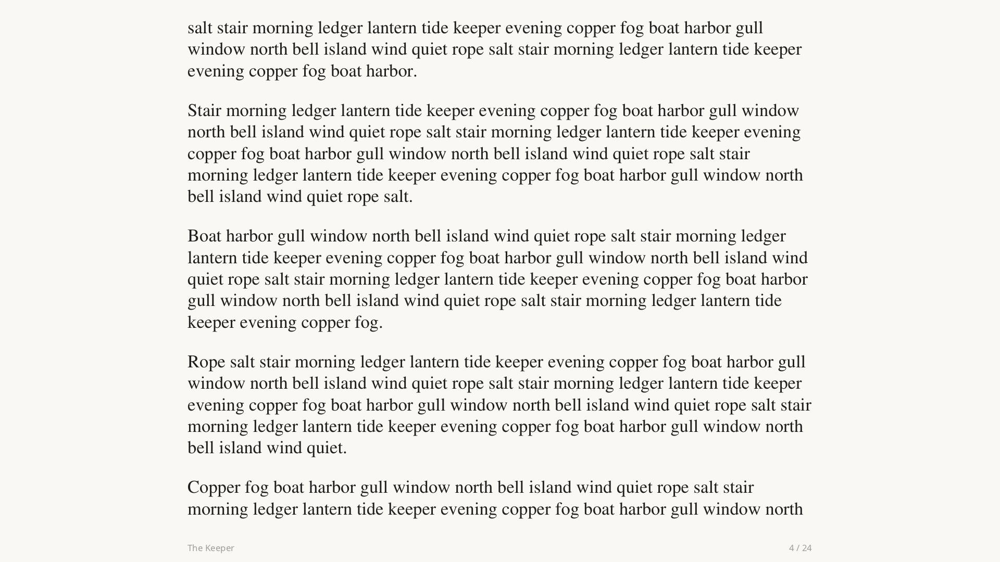
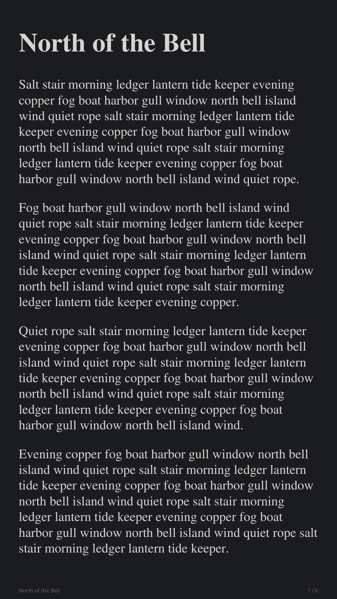
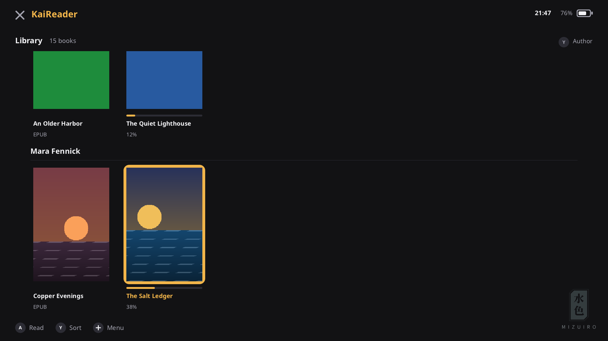
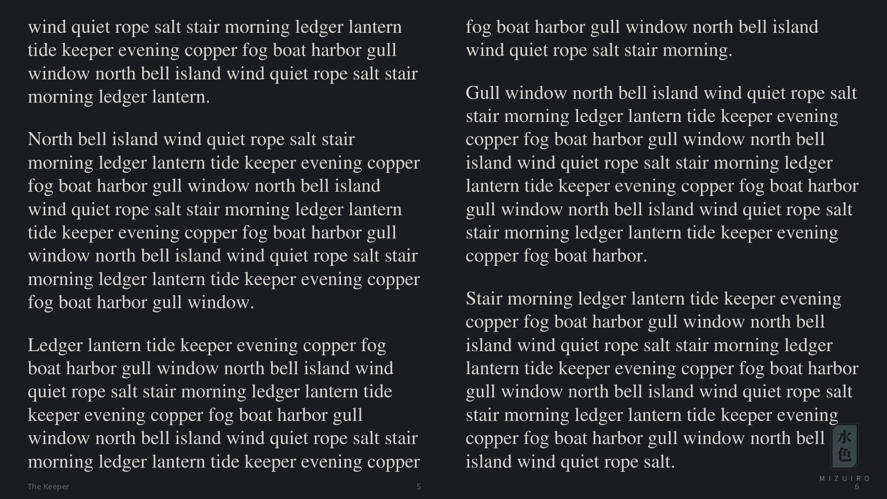
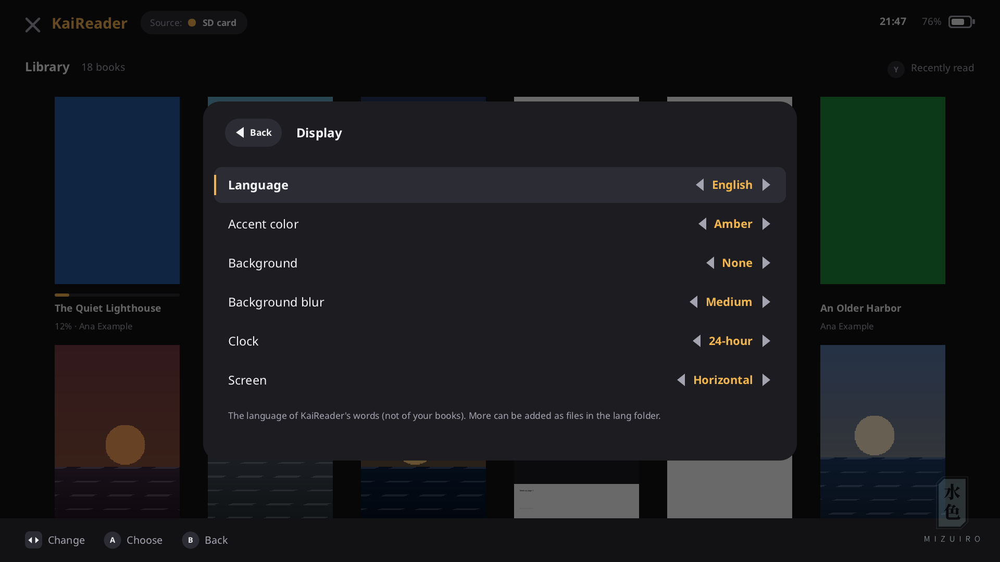

# KaiReader

<p align="center"></p>

A **book reader** for **Switch 2** running
[kaiHEN](https://github.com/ouncebrew/kaihen), a sibling of
[KaiPlayer](https://github.com/mizuiroame/kaiplayer),
[KaiRadio](https://github.com/mizuiroame/kairadio) and
[KaiVideo](https://github.com/mizuiroame/kaivideo). Your DRM-free books from
the SD card or a folder on your network, as on an e-reader: **EPUB**, **PDF**,
comics (**CBZ**, **CBR**, **CB7**, **CBT**), **FB2**, **MOBI**, **TXT** and
**XPS**, drawn with [MuPDF](https://mupdf.com/).



| Reading | Upright, like a book | Sorted by author |
|---------|----------------------|------------------|
|  |  |  |

| Two pages, like an open book | Sepia, bigger text | Settings |
|------------------------------|--------------------|----------|
|  |  |  |

The screenshots show made-up books.

> **Version 0.3, a pre-release: still young.** Only in English for now; book
> servers (OPDS, Calibre-Web, Kavita, Komga), public-domain catalogs and the
> other languages come next.

> KaiReader is an independent project. It is not affiliated with, endorsed by
> or sponsored by Nintendo or Amazon. See the [legal notice](docs/legal.md).

## What it can do

- **Library**: every book in `sdmc:/books` (and its folders), with its cover,
  title, author and how far you've read. Sorted by **recently read**, **title**,
  **author** (by surname, when the book gives it) or **genre** (the book's
  subject), with the author or genre above each group.
- **Reading**: books that flow (EPUB, FB2, MOBI, TXT) are laid out for the
  screen, with **ten text sizes** and four **colors** (light, sepia, dark and
  black: the text and the paper change, pictures keep their colors). PDFs and
  comics show their own pages, fitted to the screen.
- **Network folders**: a Windows shared folder (SMB), a NAS or Nextcloud
  (WebDAV), or an FTP or SFTP server (Settings > Network folder). Its books
  show in the library's **Network** tab (ZL/ZR); one you open is copied to
  `sdmc:/books/Network/` and stays in your library, to read without the network.
- **Zoom** on PDFs and comics: up and down, or two fingers, up to 3×; the left
  stick or a finger moves the page, drawn sharp at the screen's resolution.
- **Bookmarks**: the left stick pressed in marks the page; the Contents panel
  (X) lists them in its Bookmarks tab, with the first words of each page.
- **Two pages side by side**, like an open book (Settings > Reading > Pages),
  with the console lying down.
- **Upright, like a book**: hold the console with its right or left side down
  (Settings > Display > Screen), or let it turn as you turn the console
  (Automatic). The right stick pressed in switches. The whole app turns, and
  the buttons and the touch screen with it.
- Picks up **where you left off**, even after changing the text size.
- **Contents**: the book's table of contents, to jump to a chapter; a slider
  to jump anywhere.
- Japanese, Chinese and Korean books use the console's own fonts.
- **Touch and buttons**: tap or swipe to turn the page.

## Controls

| | Library | Reading |
|---|---|---|
| **A** | Read the book selected | Next page |
| **Right**, **R**, **ZR** / **Left**, **L**, **ZL** | Move (**ZL** / **ZR**: Library and Network tabs) | Next / previous page |
| **Up** / **Down** | Move | Bigger / smaller text; PDFs and comics: zoom |
| **X** | | Contents and bookmarks |
| **Left stick** pressed | | Bookmark the page |
| **Right stick** pressed | Upright or lying down | Upright or lying down |
| **Y** | Sort by: recent, title, author, genre | Colors |
| **−** | | Show or hide the bars |
| **B** | | Back to the library |
| **+** | Menu: Settings, Look for books again, Exit | Menu: Contents, Library, Settings, Exit |

The right stick moves like the D-pad. Upright, every direction turns with the
console: up is up as you hold it.

On the touch screen: tap the right or left side of the page to turn it, or
swipe; tap the middle for the bars.

## Install

You need a Switch 2 with **kaiHEN** running (launch a game while holding
**R** to open hbmenu), and a way to copy files to the card (OunceShell's FTP
server, for example).

1. Copy `KaiReader.nro` to `sdmc:/switch/kaireader/`.
2. Put your books in `sdmc:/books/` (folders inside it are fine).
3. Open KaiReader from hbmenu.

**Names with accents.** The console hides files and folders whose names have
accents, ñ, curly quotes or Japanese, Chinese or Korean in them: they are on
the card, but no app can list them. Copy your books with
[KaiDrop](https://github.com/mizuiroame/kaidrop), which gives them plain names
on the console and leaves your files on the PC as they are, or rename them
first. KaiReader shows each book's real title, from inside the book.

KaiReader keeps its files next to the NRO: `shelf.txt` (where you left each
book), `settings.txt` and `covers/`.

## Build

With Docker:

```
docker build -t kaireader-devkit mupdf
docker tag kaireader-devkit kaireader-devkit:before-smb
docker build -t kaireader-devkit smb
docker build -t kaireader-host -f tests/Dockerfile.host tests
.\build.ps1            # KaiReader.nro
.\build.ps1 test       # host tests with sanitizers
.\build.ps1 preview    # the screens, drawn on the PC
```

The `kaireader-devkit` image starts from KaiRadio's image (the Switch 2
devkit with libounce). The tests open made-up books written by
`tests/make_fixtures.py`.

## License

GNU AGPL 3.0 or later ([LICENSE](LICENSE)), as MuPDF is. The other parts and
their licenses are in the [legal notice](docs/legal.md).
