# Screenshots

[Back to the README](../README.md)

The screenshots show made-up books.

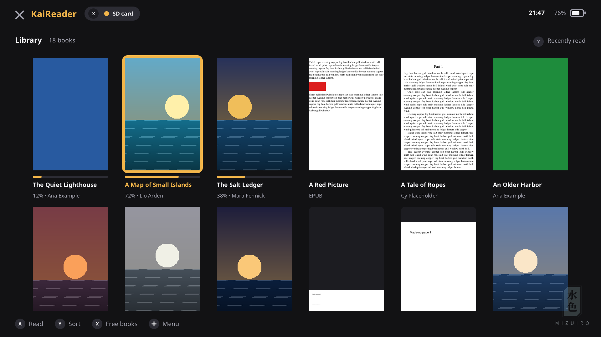

| Reading | Upright, like a book | Sorted by author |
|---------|----------------------|------------------|
| 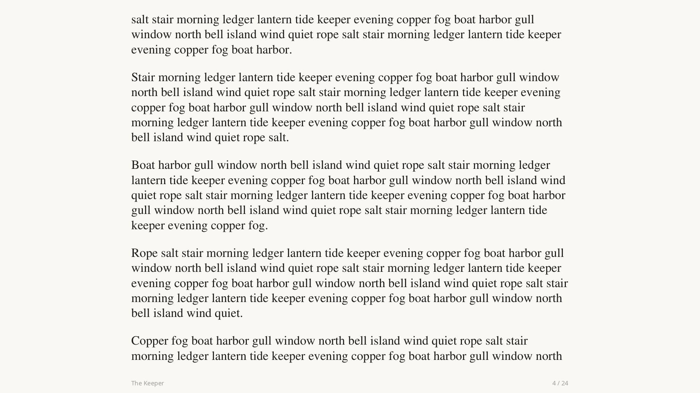 | 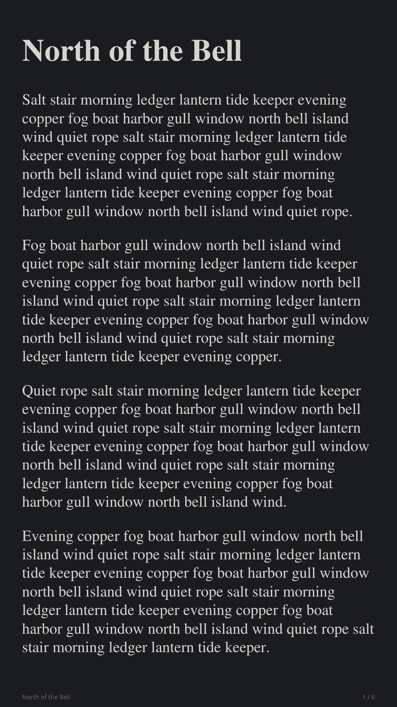 | 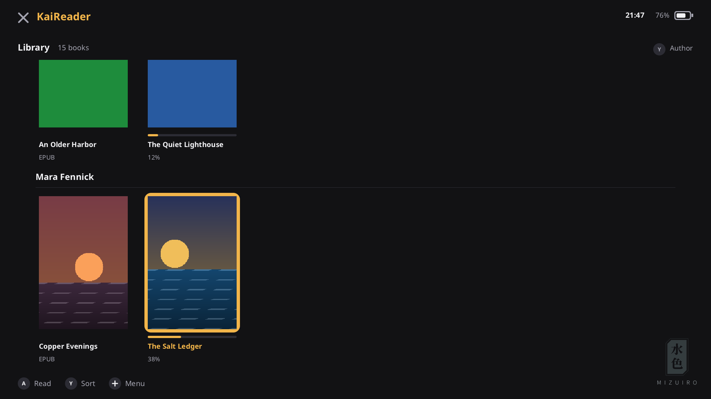 |

| Two pages, like an open book | Sepia, bigger text | Settings |
|------------------------------|--------------------|----------|
| 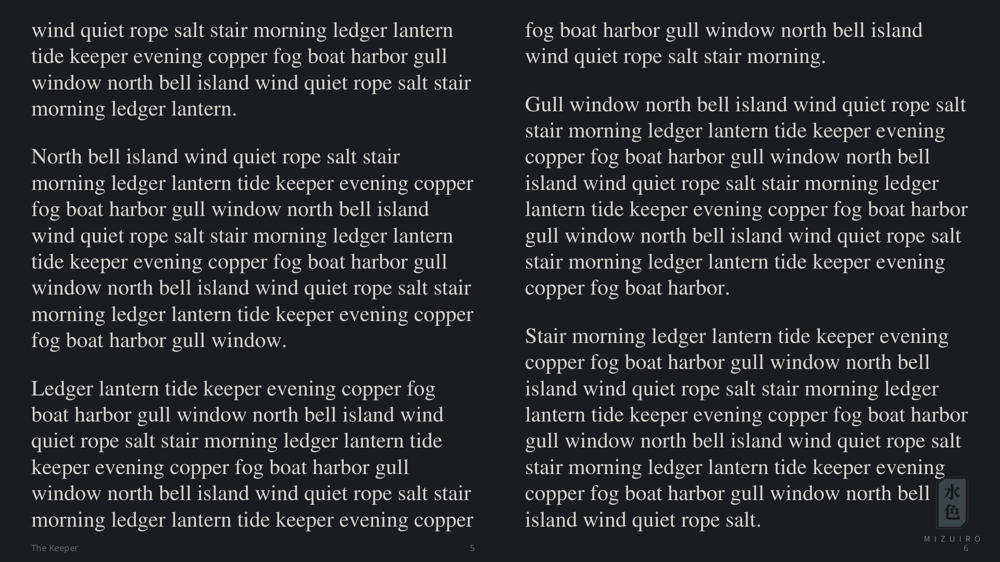 |  | 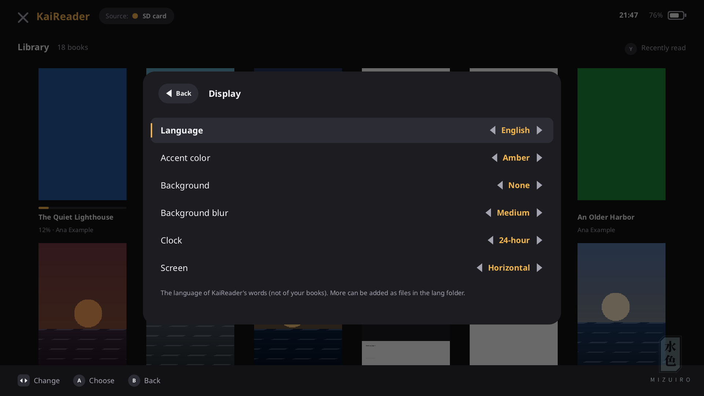 |

| A network folder's books | As a list | Favorites |
|--------------------------|-----------|-----------|
| 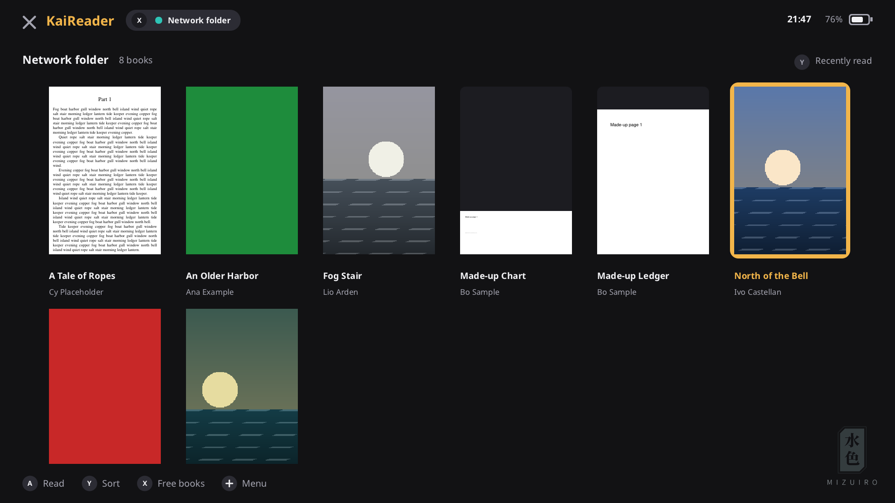 | 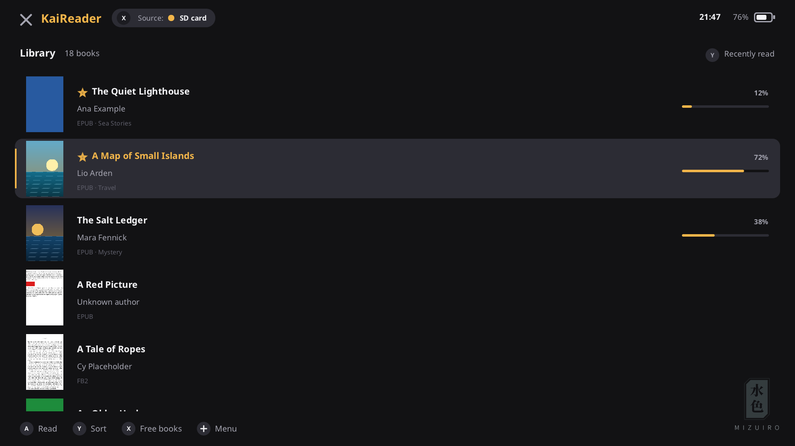 | 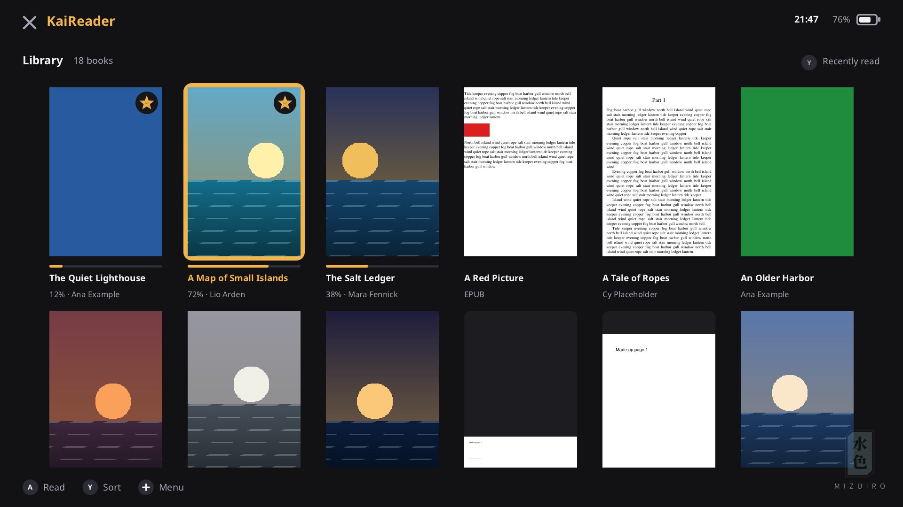 |

| Your book server (OPDS) | Free books | The + menu |
|-------------------------|------------|------------|
| 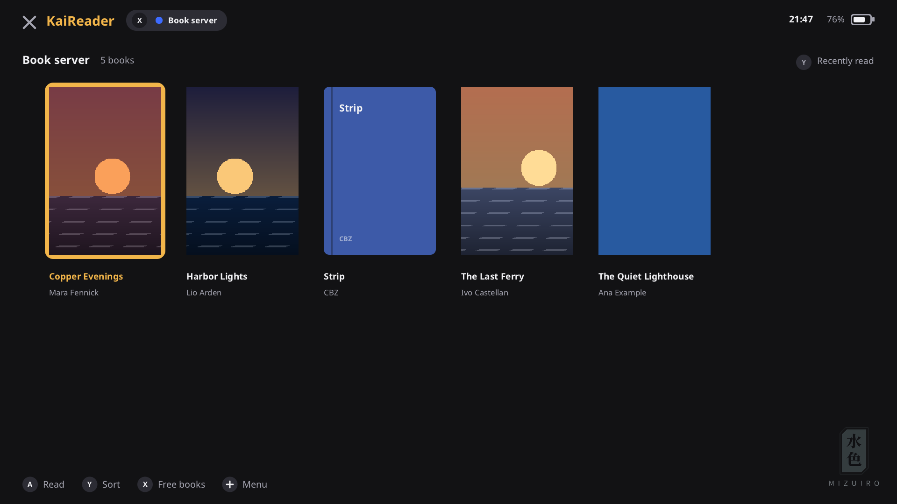 | 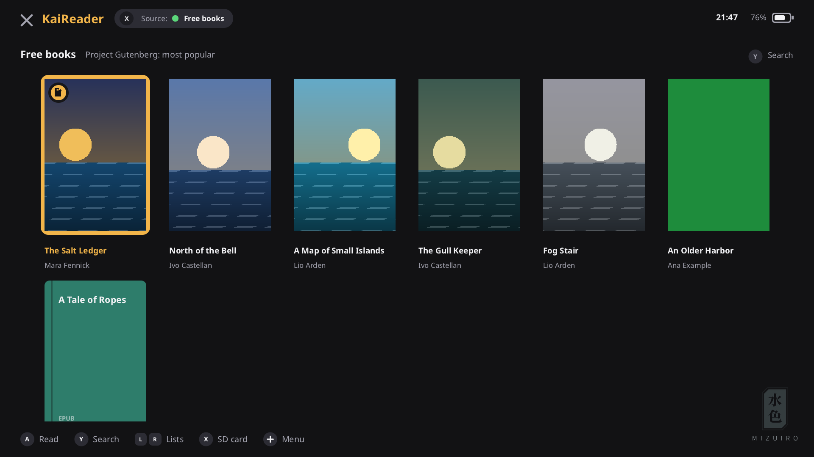 | 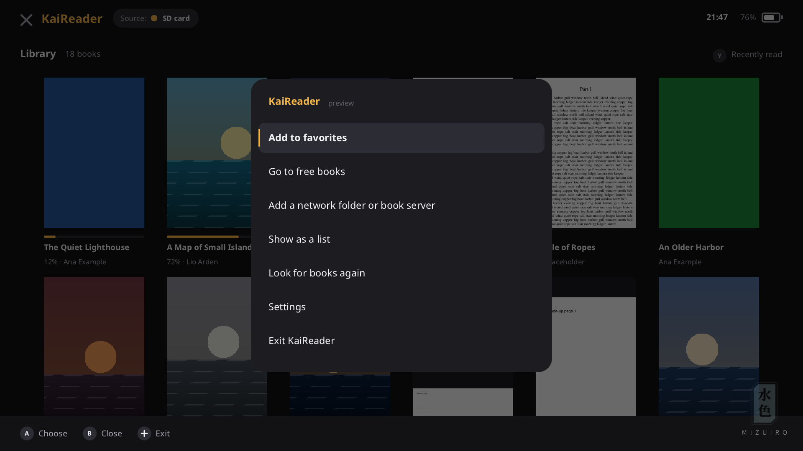 |

| Each source with its color | Credits and licenses |
|----------------------------|----------------------|
| 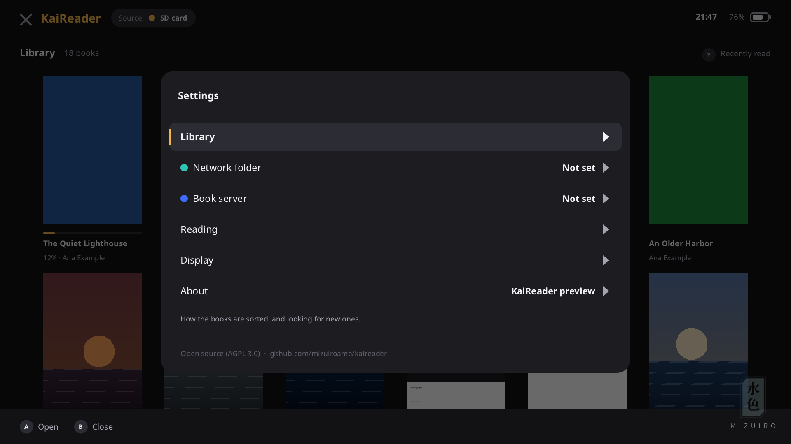 | 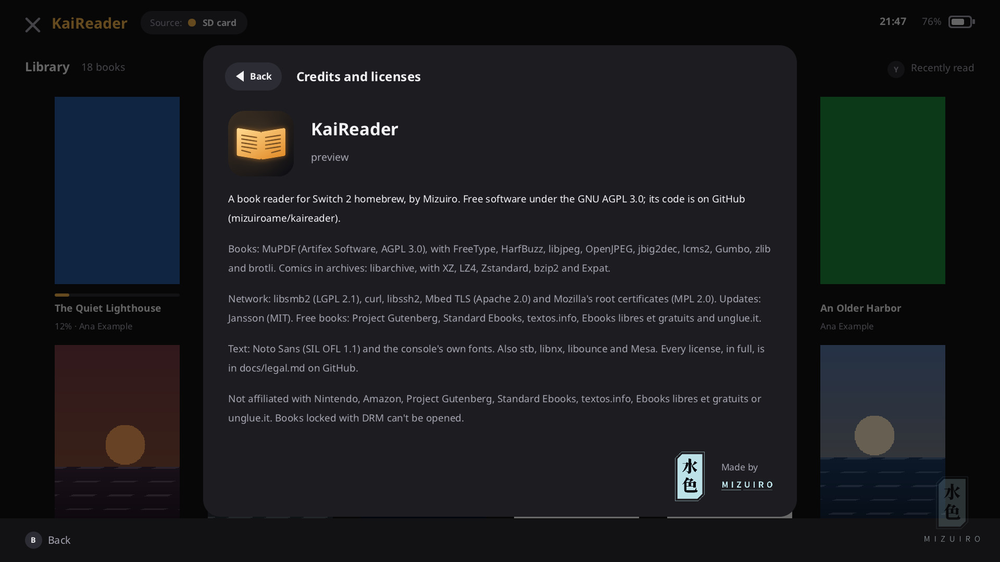 |

| A comic | Contents |
|---------|----------|
| 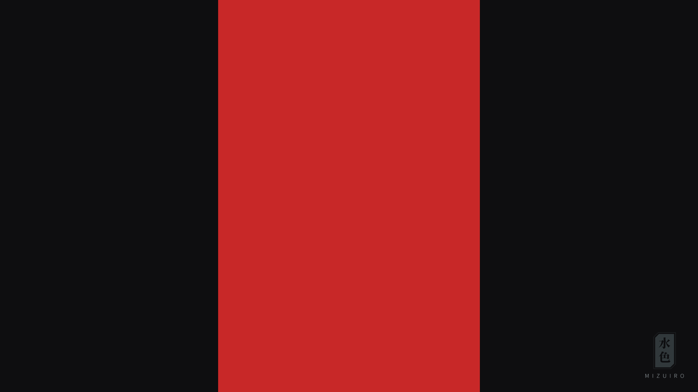 | 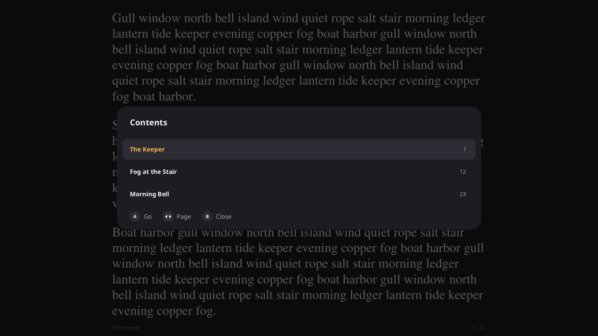 |
